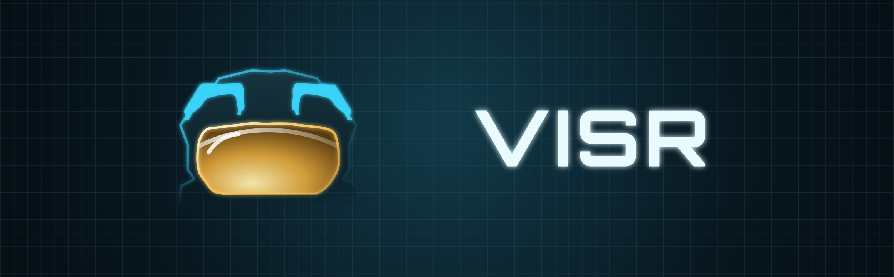

### Experience *Halo: Combat Evolved* in a whole new dimension

<!-- generated: shared: introduction -->
VISR is a native port of Halo: Combat Evolved for Apple Vision Pro and other Apple devices: iPhone, iPad, Apple TV and Mac. Based on a lot of hard work from the community, optimized for Metal and Apple Silicon.
<!-- end generated -->

<!-- generated: shared: goal -->
VISR aims to provide the best possible way to experience Halo while staying faithful to the original game. VISR builds on my love of the game and the many thousands of hours I have spent playing it.
<!-- end generated -->

VISR is an unofficial fan project, not affiliated with or
endorsed by Microsoft, Halo Studios or Bungie. See [Legal](#legal).

## On every device

<!-- generated: shared: every-device -->
- **Cross-device sync:** Your saves and player profiles sync across all your devices through iCloud. Zero setup required.
- **It just works:** VISR is specifically optimized for each Apple device for [unmatched performance](https://code.steverice.org/visr/benchmarks.html) out of the box.
- **Compatible with the community:** VISR aims for cross-play with the popular Halo: CE ports like [OpenCE](https://github.com/OpenCommunityEdition/OpenCE) and [Chupathingy](https://chupathingy.org).
<!-- end generated -->

## Apple Vision Pro

<!-- generated: features: vision-pro -->
- A whole new way to experience Halo
- Full stereo VR with head tracking and foveated rendering
- Gameplay elements reimagined for a first-class VR experience
- Immersive cutscenes true to the directorial intent
- Supports PlayStation VR2 Sense controllers for hand-tracked gunplay
- Works on both M2 and M5 Vision Pro
- visionOS 2 or later
<!-- end generated -->

VISR also plays in 2D, in a window or on a virtual screen in the room (theater
mode). A game controller is required.

Settings live in `config.toml` in the VISR folder in Files.
[ROADMAP.md](ROADMAP.md) names the setting behind each feature, and
[port/ios/README.md](port/ios/README.md) describes the display and renderer
settings.

## iPhone and iPad

<!-- generated: features: iphone-and-ipad -->
- Built-in touch controls for an on-the-go experience
- Full controller support
- Play on a TV or monitor via cable or AirPlay
- iPhone 8 or newer
- iOS/iPadOS 16 or later
<!-- end generated -->

## Apple TV

<!-- generated: features: apple-tv -->
- Full controller support
- Split-screen multiplayer on one TV
- Apple TV HD or 4K
- tvOS 16 or later
<!-- end generated -->

## Mac

<!-- generated: features: mac -->
- Native AppKit app
- Keyboard and mouse support
- Any size, full screen or windowed
- Any Apple Silicon Mac, macOS 14 or later
<!-- end generated -->

## Get the app

Each run of the [iOS workflow](https://github.com/steverice/visr/actions/workflows/ios.yml)
uploads unsigned IPAs as artifacts: `visr-visionos-unsigned` for Apple Vision
Pro, `visr-ios-unsigned` and `visr-tvos-unsigned` for the others. GitHub keeps
them for 14 days. Sign one with your own Apple account
([AltStore](https://faq.altstore.io/) and [Sideloadly](https://sideloadly.io/faq)
have guides), or build from source. Keep the same bundle ID when you update,
and your saves carry over.

The app reserves a 4 GB address range for the game's 32-bit memory at launch.
If a Vision Pro refuses it, launching shows "Could not reserve the game's 4 GB
memory arena". Build with `--extended-virtual-addressing`, which needs a paid
developer team; it works for iPhone, iPad, Apple TV and Vision Pro builds.

## Game data

You need a disc image (`.iso` or `.xiso`) of the original Xbox release:

- NTSC-US, map build `01.10.12.2276`
- PAL, map build `01.01.14.2342`

PC, Custom Edition and Master Chief Collection files do not work.

Open VISR, tap **Choose XISO** and pick the image in Files, or copy one image
into the VISR folder before launching. The importer checks the image's file
system, map build and campaign maps before it copies anything, then extracts
the maps and starts the game. Later launches go straight to the game, and you
can delete the image. Saves live in the `save` folder inside the VISR folder;
back it up before you delete the app. A build made with `--cloud-saves` also
copies profiles and campaign saves to your private iCloud storage, so they
follow you between devices; see [iCloud saves](docs/cloud-saves.md) for what
is copied, the privacy notes and how to build with it.

> [!WARNING]
> **Do not ask** where to obtain an XISO. If you do not have an XISO from your own,
> legally purchased copy of Halo: Combat Evolved then this project is not for you.

## Shader improvements

VISR automatically sends missing shader descriptions and device model information to improve loading. Reports exclude gameplay and personal file names. Apple's upload service attaches an account-specific identifier. Turn off Share shader improvements in settings to stop future contributions.

See [shader contribution privacy](port/ios/privacy/README.md) for retention and build policy.

## Build from source

You need an Apple silicon Mac with Xcode, Python 3 and Homebrew. The validated
toolchain is Xcode 27 with Homebrew LLVM and LLD 23.1.2. Add your Apple account
in Xcode > Settings > Accounts before a signed build.

```sh
git clone https://github.com/steverice/visr.git
cd visr
brew install cmake ninja llvm lld sdl3 pkgconf

# Regression tests
python3 tools/ios_test.py

# Apple Vision Pro: signed, unsigned IPA, simulator
python3 tools/ios_build.py --visionos --team YOUR_TEAM_ID --bundle-id com.yourname.visr
python3 tools/ios_build.py --visionos --unsigned --ipa dist/VISR-visionOS-unsigned.ipa
python3 tools/ios_build.py --visionos --simulator

# iPhone and iPad, Apple TV, Mac
python3 tools/ios_build.py --team YOUR_TEAM_ID --bundle-id com.yourname.visr
python3 tools/ios_build.py --tvos --team YOUR_TEAM_ID --bundle-id com.yourname.visr
python3 tools/ios_build.py --mac
```

The build script downloads SDL, musl and the Khronos headers itself. The
[build and install guide](port/ios/README.md) covers installing from the
command line, the simulator, display and renderer settings, the
[Apple Vision Pro build](port/ios/README.md#apple-vision-pro) and
troubleshooting.

## Roadmap

See [ROADMAP.md](ROADMAP.md).

## Repository layout

- `source/` is the decompiled game, from the upstream decompilation projects
- `port/runtime` is the portable runtime for the game's 32-bit pointers on
  ARM64
- `port/ios` is the Apple app: UIKit, touch controls, audio, the loader, the
  disc importer, the Metal renderer and the visionOS scenes
- `port/linux` holds the platform layer, the OpenGL renderer and the Xbox
  compatibility layer shared with the upstream desktop ports, which still
  build from this tree (see [README.upstream.md](README.upstream.md))
- `tools/` has the build, packaging and test scripts

## Reporting bugs and contributing

[Open an issue](https://github.com/steverice/visr/issues) with your device, OS
version, the app's version and what you were doing. `ios-runtime.log` and
`debug.txt` in the VISR folder help; skim them for anything personal first, and
do not attach game files or disc images. Security problems go through
[SECURITY.md](SECURITY.md). See [CONTRIBUTING.md](CONTRIBUTING.md) and the
[code of conduct](CODE_OF_CONDUCT.md).

## Credits

- [punpckhdq/halo](https://github.com/punpckhdq/halo), the original Halo: CE
  decompilation
- [bnunu/halo-1](https://github.com/bnunu/halo-1), bnunu's fork of the
  decompilation, with Jonas Volman and the other contributors in its history
- [OpenCE](https://github.com/OpenCommunityEdition/OpenCE) (formerly
  cybersecurity/halo-ce-universal), the native ports this one is based on:
  the ARM64 runtime, the renderer, audio, the high-resolution HUD and menus,
  and multiplayer
- [NicholasDominici/halo-ce-ios](https://github.com/NicholasDominici/halo-ce-ios),
  the iOS port this repository started from: the 32-bit pointer model on
  ARM64, the iOS host and the on-device importer
- [pfista/halo-og](https://github.com/pfista/halo-og), Michael Pfister's port
  with a native Metal renderer for macOS: exact texture border colors, pixel
  shader combiner fixes, and the pre-HUD spot for post-processing
- [LivingFray/HaloCEVR](https://github.com/LivingFray/HaloCEVR), a full VR
  conversion mod for the 2003 PC Edition of the game, which provided design
  inspiration for some of the VR decisions
- [xemu](https://xemu.app/), the Xbox emulator, whose model of the Xbox GPU's
  pixel shaders the shader translators follow


The fonts are Overpass and OpenCE (SIL Open Font License 1.1) and Newtown by
Roger White (public domain). The third-party libraries and their licenses are
listed in [NOTICE.md](NOTICE.md).

## License

VISR is licensed under Apache-2.0 (see [LICENSE](LICENSE)). It includes code
that originated in CC0 1.0 projects, credited in [NOTICE.md](NOTICE.md), which
also lists the third-party components that keep their own licenses. Halo, its game content
and its trademarks are the property of Microsoft. VISR contains no game assets,
grants no rights in Microsoft's property, and requires players to supply their
own copy of the game.

## Legal

<!-- generated: shared: legal -->
Halo, Halo: Combat Evolved, Master Chief and the related names and logos are
trademarks of Microsoft Corporation. Halo: Combat Evolved © Microsoft
Corporation. VISR is an unofficial fan project. It is not affiliated with,
sponsored by or endorsed by Microsoft, Xbox Game Studios, Halo Studios
(formerly 343 Industries) or Bungie.

VISR does not include or distribute the game's maps, sounds, textures, videos or other content, and it does not help you obtain them. You need a disc image of the original Xbox game, made from your own disc. VISR is free and is not sold.

It builds on the Halo: CE decompilation, [OpenCE](https://github.com/OpenCommunityEdition/OpenCE) and the other projects in its [credits](https://github.com/steverice/visr#credits). The code is licensed under [Apache-2.0](https://github.com/steverice/visr/blob/main/LICENSE). It includes code that originated in CC0 1.0 projects, credited in the [notices](https://github.com/steverice/visr/blob/main/NOTICE.md).

Apple, iPhone, iPad, Apple TV, Mac, Vision Pro and Metal are trademarks of Apple Inc.
<!-- end generated -->
