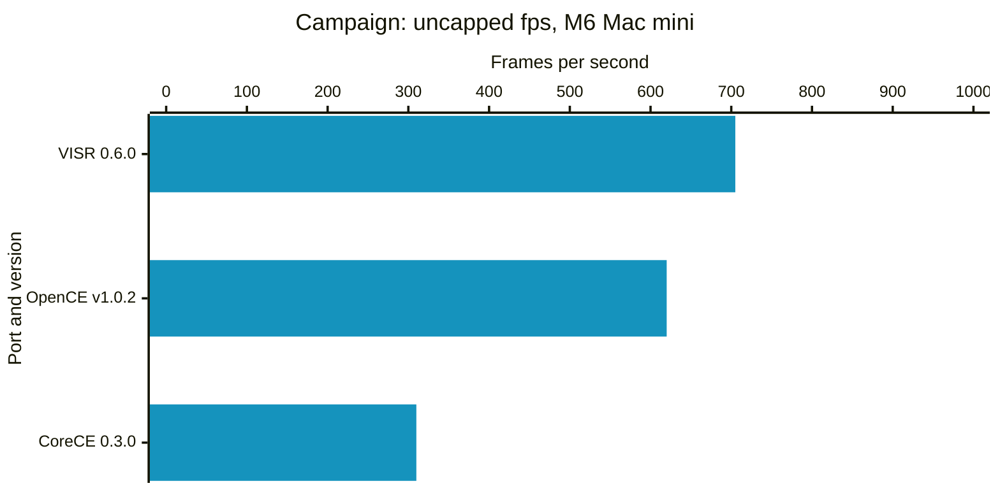

# Performance benchmarks

We try to make these comparisons fair, but our numbers or our setup for other projects may be wrong or out of date. Corrections? Updates? A new port or build we should add? [Open an issue](https://github.com/steverice/visr/issues)

Last measured: 2026-10-27. The [results spreadsheet](https://docs.google.com/spreadsheets/d/1tuTJpOxUTbqgzOSDSW-nSvWKL8HkZMVucvNRUIee0t4) holds every number. The [interactive version](https://code.steverice.org/visr/benchmarks.html) adds suites and a choice of builds. The methodology is at the bottom of this page.

## Results

Campaign suite, newest build of each port.

<!-- BEGIN CHARTS -->

### Mac

Average presentation rate, with the frame cap and vsync off and the matched-stock settings. Each bar is the geometric mean of the average over the suite's windows. Under the chart, each build lists the median and 90th-percentile GPU time per rendered frame.

🟦 Average fps

Higher is better.

M6 Mac mini. [VISR 0.6.0](https://github.com/steverice/visr/releases/tag/visr-v0.6.0) (build 20261027.111952, measured 2026-10-27; 0.48 ms median GPU time per rendered frame, 0.73 ms 90th-percentile GPU time per rendered frame); [OpenCE-macOS v1.0.2](https://github.com/channelramble/OpenCE-macOS/releases/tag/v1.0.2) (build 2, measured 2026-10-26; 0.55 ms median GPU time per rendered frame, 0.75 ms 90th-percentile GPU time per rendered frame); [CoreCE 0.3.0](https://github.com/mastercheese-dev/CoreCE/releases/tag/build-44) (build 44, measured 2026-10-26; 0.81 ms median GPU time per rendered frame, 1.11 ms 90th-percentile GPU time per rendered frame).

Not measured: [OpenCE web build-280](https://halocombatevolved.com/) (Only measured with the frame cap on or with other settings.); [Chupathingy v0.8.0g](https://github.com/ChupathingyCE/chupathingyce/releases/tag/v0.8.0g) (The app has no frame-time readout we could capture.); [Halo OG v0.5.1](https://github.com/pfista/halo-og/releases/tag/v0.5.1) (The app has no frame-time readout we could capture.).

### iPhone and iPad

Average presentation rate and 1% low rate (the slowest 1% of frames), from runs presented at the device's display rate. Each bar pair is the geometric mean of the average and of the 1% low over the suite's windows. Under the chart, each build lists the share of frames that arrive on time (within 5% of the display interval) where the app reports it. A build measured in only some of the suite's windows is charted from those windows, and the caption names the windows still to measure.

```mermaid
---
config:
  xyChart:
    width: 860
    height: 420
  themeVariables:
    xyChart:
      plotColorPalette: "#1593bd, #c8870a"
---
xychart-beta horizontal
    title "Campaign: fps at display rate, M1 iPad Pro"
    x-axis "Port and version" ["VISR 0.6.0", "Beeman apple-v0.3.0", "ChupathingyCE iOS v0.2.0 (pre-release)"]
    y-axis "Frames per second" 0 --> 150
    bar [119.5, 119.4, 119.1]
    bar [119.5, 119.4, 119.1]
```

🟦 Average fps 🟨 1% low fps

Higher is better.

M1 iPad Pro. [VISR 0.6.0](https://github.com/steverice/visr/releases/tag/visr-v0.6.0) (build 20261027.111952, measured 2026-10-27; no on-time share reported); [Beeman apple-v0.3.0](https://github.com/bmanturner/halo-ce-universal/releases/tag/apple-v0.3.0) (build unknown, measured 2026-10-27; no on-time share reported; b30 not measured yet); [ChupathingyCE iOS v0.2.0 (pre-release)](https://github.com/JizzyRivers/chupathingyce-ios/releases/tag/v0.2.0) (build 0.8.0h-dev d7fafc8, measured 2026-10-27; no on-time share reported; b30 not measured yet).

Not measured: [HaloPad v0.3.12](https://github.com/chrissotraidis/projectreach/releases/tag/v0.3.12) (Not run on this device yet.); [SnailBBQ v0.2.118-beta](https://github.com/SnailBBQ/Halo-CE-IOS/releases/tag/v0.2.118-beta) (Not run on this device yet.).

### Apple TV

Average presentation rate and 1% low rate (the slowest 1% of frames), from runs presented at the frame cap of the device's profile, 30 fps on the Apple TV HD. Only VISR has Apple TV builds. Each bar pair is the geometric mean of the average and of the 1% low over the suite's windows. Under the chart, each build lists the share of frames that arrive on time (within 5% of the display interval) where the app reports it.

```mermaid
---
config:
  xyChart:
    width: 860
    height: 420
  themeVariables:
    xyChart:
      plotColorPalette: "#1593bd, #c8870a"
---
xychart-beta horizontal
    title "Campaign: fps at the profile's frame cap, Apple TV HD"
    x-axis "Port and version" ["VISR 0.6.0"]
    y-axis "Frames per second" 0 --> 40
    bar [29.8]
    bar [29.8]
```

🟦 Average fps 🟨 1% low fps

Higher is better.

Apple TV HD. [VISR 0.6.0](https://github.com/steverice/visr/releases/tag/visr-v0.6.0) (build 20261027.111952, measured 2026-10-27; no on-time share reported).

### Vision Pro

Average presentation rate and 1% low rate (the slowest 1% of frames), from runs presented at the device's display rate. Each bar is the geometric mean of the average over the suite's windows, drawn beside the 1% low where the app reports one. Under the chart, each build lists its 95th-percentile frame time and the share of frames that arrive on time (within 5% of the display interval) where the app reports them. VISR replays a recorded route; master-chef runs with no input. master-chef: Fixed at 30 fps as shipped; it has no setting to run faster and reports no frame times.

```mermaid
---
config:
  xyChart:
    width: 520
    height: 263
  themeVariables:
    xyChart:
      plotColorPalette: "#1593bd, #c8870a"
---
xychart-beta horizontal
    title "Campaign: fps at display rate, M2 Vision Pro"
    x-axis "Port and version" ["VISR 0.6.0", "master-chef 1.0.3"]
    y-axis "Frames per second" 0 --> 150
    bar [89.4, 29.8]
    bar [76.8, 0]
```

🟦 Average fps 🟨 1% low fps

Higher is better.

M2 Vision Pro. [VISR 0.6.0](https://github.com/steverice/visr/releases/tag/visr-v0.6.0) (build 20261027.111952, measured 2026-10-27; 11.8 ms 95th-percentile frame time, 94.1% of frames on time); [master-chef 1.0.3](https://github.com/mitchaiet/master-chef/releases/tag/v1.0.3) (build 103, measured 2026-10-27; no frame times reported).

<!-- END CHARTS -->

## Methodology

The snapshot holds 57 measured windows for 7 ports on 4 platforms (Mac, iPhone/iPad, Apple TV, Vision Pro). Each window's value is the mean over its valid rounds. A bar is the geometric mean of the windows' average presentation rates, drawn beside the geometric mean of their 1% low rates (1000 divided by the 99th percentile interval). When a build was measured on several dates, the newest set is charted. Sets with fewer than three rounds, and targets that could not run, stay in the spreadsheet with their status. On-time share uses the recorded display rate with a 5% interval tolerance, is omitted for uncapped rows and does not establish a display tier. The methods measure different events and are not ranked against one another. Only released builds are shown. Web builds run in a browser that always syncs to the display, so they have capped numbers only and do not appear in the uncapped charts. The spreadsheet's README tab describes each column.

### Timing by platform

- **Mac** (M4 Mac mini, M6 Mac mini; frame cap on and uncapped): Metal's per-frame timing: `metalperftrace` on-glass drawable intervals for the app's process. Ports: VISR, OpenCE-macOS, CoreCE.
- **Mac** (M4 Mac mini, M6 Mac mini; frame cap on): Safari `requestAnimationFrame` callbacks, which measure browser scheduling. Ports: OpenCE web.
- **iPhone/iPad** (M1 iPad Pro; frame cap on): Instruments Metal System Trace recorded over the network; each frame's time is a row of the `displayed-surfaces-interval` table. Against VISR's own frame log over the same window, average rate and p95/p99 agree within 1%. Ports: VISR, Beeman, ChupathingyCE iOS.
- **Apple TV** (Apple TV HD; frame cap on): Instruments Metal System Trace recorded over the network; each frame's time is a row of the `displayed-surfaces-interval` table. Against VISR's own frame log over the same window, average rate and p95/p99 agree within 1%. Ports: VISR.
- **Vision Pro** (M2 Vision Pro; frame cap on): The app's own benchmark report: VISR's report, or the telemetry of a port that has no timing tool, counted over the same warm-up and sampling window. Ports: master-chef, VISR.

master-chef runs at a fixed 30 fps as shipped, below the 90 Hz display, so it has no uncapped rows.

iPhone/iPad, Apple TV, and Vision Pro charts use runs presented at the device's display rate or, where its profile sets a lower frame cap, at that cap, not an uncapped mode. Their on-time share (frames within 5% of the display interval) is in the spreadsheet, and a device that holds its display rate shows an average near that rate. The Mac chart uses the uncapped, matched-stock runs described below.

### Uncapped charts

Uncapped charts show average fps and GPU time per rendered frame, not 1% low rates. When a game renders faster than the display refreshes, macOS hands drawables to the window server in bursts, so the on-glass intervals record when the window server latches drawables rather than the frames a player sees; VISR's intervals alternate between about 0 ms and about 5 ms. Percentiles of those intervals, the 1% low included, describe that latching. The average counts frames shown per second and is not affected. GPU time per rendered frame comes from the same Metal trace. A game that renders several frames for each frame it shows has all of their GPU time added to the next shown frame, so each shown interval's GPU time is split by its command buffers, one per rendered frame, and reported as the median and the 90th percentile over rendered frames. Capped and device charts keep the 1% low and add the share of frames that arrive on time. The spreadsheet keeps every column.

### Suites

- **Campaign:** every measured window: the opening of a10, the opening of b30, and the b30 beach encounter 90 seconds later (`b30 +90 s`). One player, no input, default enemies. Each window warms up for 15 seconds after player readiness, takes a five-second background CPU baseline, then samples for 60 seconds. Three rounds per set. A set with fewer than three valid rounds is marked incomplete. Measured on 7 ports: VISR, OpenCE-macOS, OpenCE web, CoreCE, master-chef, Beeman, ChupathingyCE iOS.
- **Multiplayer:** a hosted Slayer match on Chill Out and one on Blood Gulch, each a sampling window; the suite value is the mean over both maps' windows. One local player, driven by the scripted bot input, hosts and starts the match with no other humans. Bot input is paced from the wall clock, so runs on different ports, and repeated runs on one port, play equivalent workloads, not identical replays. No measurements yet.
- **Co-op:** local split-screen campaign co-op, two players. Enemy scaling is set explicitly to static 1x on every port that has the option: VISR sets `debug.enemy_multiplier = 1`, and OpenCE-macOS and CoreCE set their enemies-per-player scaling to static 1x. A port without the option runs its own fixed behavior, and its notes column in the spreadsheet says so. A port without split screen shows "Does not support split screen" and the status `not_supported`; that differs from "not measured", which means the suite has not been run for the build. No measurements yet.
- **Overall:** per build, the geometric mean of the suites' average rates and the geometric mean of their 1% low rates, each suite weighted equally, so every suite counts the same whatever its frame-rate scale. Each chart uses the suites that every build drawn in it has measured, so its bars stay comparable; the caption names them. Ticking or unticking a build can change which suites a chart covers.

A round is rejected when the outside-process CPU average rises more than half a core above the baseline taken before the window. Each round allows three attempts. Rejected attempts appear in the spreadsheet with the status `rejected` and their reason. This snapshot has 0 rejected attempts.

Suite definitions and the harness are in [`tools/perf_compare`](https://github.com/steverice/visr/blob/main/tools/perf_compare) ([`adapters.py`](https://github.com/steverice/visr/blob/main/tools/perf_compare/adapters.py), [`refresh.py`](https://github.com/steverice/visr/blob/main/tools/perf_compare/refresh.py)).

Background CPU is sampled for five seconds immediately before each native sampling window. Runs are rejected when average outside-process CPU rises more than half a core above that baseline. Steady background work remains active and may affect these estimates. Each round allows up to three attempts; rejected attempts do not enter the ranges.

Opening runs use a10 and b30 with no input: 15 seconds of warm-up after player readiness, a five-second background CPU baseline, then 60 seconds of sampling. Opening cinematics are included. Native apps use 1280×960 drawables on a 60 Hz display with interpolation. Capped rows request a 60 fps cap and keep each app's other graphics defaults. These runs do not establish combat performance or identical image quality. Player readiness does not align cinematic clocks, so opening sequences can have phase offsets between apps.

Uncapped runs request `display.frame_rate = "unlimited"` in VISR, `display.max_fps = -1` in OpenCE-macOS, and `display.frame_limit = 0` in CoreCE, with `display.vsync = false` and interpolation enabled in each. The `frame_mode` and `delay_s` columns of the spreadsheet identify each mode and extra delay after warm-up (0 s is the opening window). The 60 Hz display still limits visible refreshes; presentation intervals do not establish simulation speed or unique displayed frames. Above-refresh trace rates have unverified physical meaning and are not verified submission throughput. The same elapsed window does not prove identical gameplay. Each launch uses fresh isolated data/save folders; OS and driver caches are not reset or equalized.

The matched-stock preset disables antialiasing, replacement HUD/text, and first-person legs in each native app, and each uses direct camera and 128-pixel shadow maps. VISR also uses automatic model LOD, the Xbox-size effect buffer, 1× anisotropic filtering, no replacement textures, and no first-person body. OpenCE-macOS uses native resolution scaling, stock world/weapon FOV, and disables optional per-pixel lighting, weapon shields, and shield glow. CoreCE uses the same options as OpenCE-macOS and `model_detail = "stock"`. Other defaults remain unchanged. VISR uses native Metal and compressed GPU textures; OpenCE-macOS uses ANGLE over Metal. These runs could not verify the other ports' internal filtering, LOD, effect-buffer, or texture-storage policy, so identical image quality remains unverified. Weapon framing and texture filtering still differ visibly. Capped rows keep each app's graphics defaults and are not quality-matched to the matched-stock rows.

Configuration references: [VISR settings](../port/ios/README.md), [OpenCE-macOS v1.0.2 settings](https://github.com/channelramble/OpenCE-macOS/blob/v1.0.2/port/linux/README.md#settings), [CoreCE graphics settings](https://github.com/mastercheese-dev/CoreCE/blob/cccbf6fcc/README.md#graphics).

The later b30 window adds 90 seconds after warm-up, reaching the beach encounter at about 110 seconds after player readiness once the CPU baseline is included. It samples 60 seconds with a stationary player and no input. Start/end screenshots qualify the camera location, but AI and combat state can vary between apps and rounds; this is not a deterministic combat replay.

OpenCE web runs import the disc image into each fresh Safari automation session, start the level with the documented `?map=<level>&play`, wait 6 seconds for loading, then warm up for 15 seconds and sample requestAnimationFrame callbacks for 60 seconds with no input. The page viewport is 640×480 points, so the game canvas is 1280×960 pixels on the same 60 Hz display as the native rows. The page does not report player readiness, so its sampling window can be offset from the native windows within the opening sequences. Browser callbacks are not the same event as native on-glass intervals.

CoreCE rows come from separate matrices run after the VISR and OpenCE-macOS matrices on the same hosts and dates, so they do not share round rotation with them. CoreCE reads the same maps from a copied folder, because its Mac host does not accept a linked maps folder.

Apple's metalperftrace records per-frame on-glass drawable intervals. CPU/GPU durations and aggregate FPS are excluded. Repeated image content is not detected.

Instruments Metal System Trace records the displayed-surfaces-interval table over the network: the time each frame is swapped onto the display. Repeated image content is not detected.

The app's own benchmark report counts the frames it presents; its intervals are the app's, not the display's.

Safari callbacks measure browser scheduling and may include repeated game images; they do not prove unique game frames.
