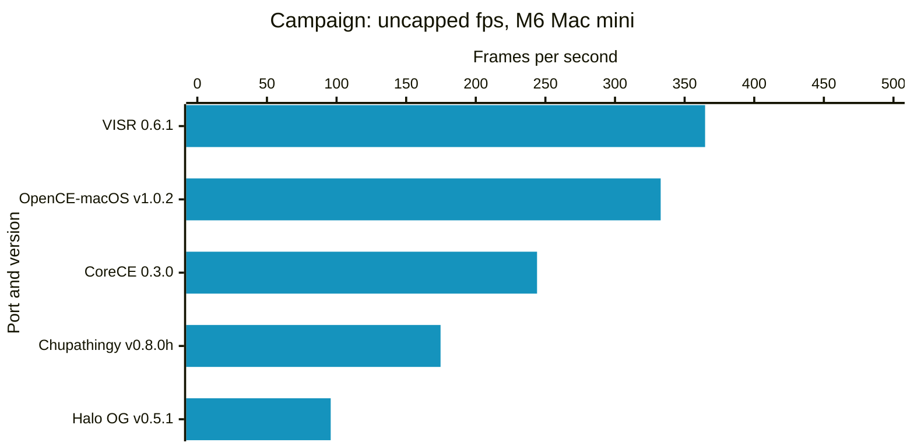

```mermaid
---
config:
  xyChart:
    width: 860
    height: 420
  themeVariables:
    xyChart:
      plotColorPalette: "#1593bd, #c8870a"
---
xychart-beta horizontal
    title "Campaign: fps at display rate, M1 iPad Pro"
    x-axis "Port and version" ["VISR 0.6.0", "Beeman apple-v0.3.0", "ChupathingyCE iOS v0.2.0 (pre-release)"]
    y-axis "Frames per second" 0 --> 150
    bar [119.5, 119.4, 119.1]
    bar [119.5, 119.4, 119.1]
```

```mermaid
---
config:
  xyChart:
    width: 860
    height: 420
  themeVariables:
    xyChart:
      plotColorPalette: "#1593bd, #c8870a"
---
xychart-beta horizontal
    title "Campaign: fps at the profile's frame cap, Apple TV HD"
    x-axis "Port and version" ["VISR 0.6.0"]
    y-axis "Frames per second" 0 --> 40
    bar [29.8]
    bar [29.8]
```

# Performance benchmarks

We try to make these comparisons fair, but numbers or projects may be wrong or out of date. Corrections? Updates? A new port or build we should add? [Open an issue](https://github.com/steverice/visr/issues/new?template=benchmark.yml)

Last measured: 2026-10-28.

The [results spreadsheet](https://docs.google.com/spreadsheets/d/1tuTJpOxUTbqgzOSDSW-nSvWKL8HkZMVucvNRUIee0t4) holds every number. The [interactive version](https://code.steverice.org/visr/benchmarks.html) adds suites and a choice of builds. The methodology is at the bottom of this page.

## Results

Campaign suite, newest build of each port.

<!-- BEGIN CHARTS -->

### Mac

Measured on an M6 Mac mini with the frame cap and vsync off, the matched-stock settings and a 2560×1920 drawable. Bars show average fps; the table lists median and 90th-percentile GPU time per rendered frame.

🟦 Average fps

Higher is better.

M6 Mac mini. [VISR 0.6.1](https://github.com/steverice/visr/releases/tag/visr-v0.6.1) (build 20261027.174748, measured 2026-10-27; 4.15 ms median GPU time per rendered frame, 5.02 ms 90th-percentile GPU time per rendered frame); [OpenCE-macOS v1.0.2](https://github.com/channelramble/OpenCE-macOS/releases/tag/v1.0.2) (build 2, measured 2026-10-28; 5.17 ms median GPU time per rendered frame, 7.57 ms 90th-percentile GPU time per rendered frame); [CoreCE 0.3.0](https://github.com/mastercheese-dev/CoreCE/releases/tag/build-44) (build 44, measured 2026-10-28; 2.63 ms median GPU time per rendered frame, 3.38 ms 90th-percentile GPU time per rendered frame); [Chupathingy v0.8.0h](https://github.com/ChupathingyCE/chupathingyce/releases/tag/v0.8.0h) (build 0.8.0h, measured 2026-10-28; GPU time per frame not available (OpenGL)); [Halo OG v0.5.1](https://github.com/pfista/halo-og/releases/tag/v0.5.1) (build 97.1, measured 2026-10-28; 4.1 ms median GPU time per rendered frame, 5.9 ms 90th-percentile GPU time per rendered frame).

Not measured: [VISR 0.6.3](https://github.com/steverice/visr/releases/tag/visr-v0.6.3) (The campaign suite has not been run for this build.); [VISR 0.6.0](https://github.com/steverice/visr/releases/tag/visr-v0.6.0) (Only measured with the frame cap on, at another size or with other settings.); [VISR 0.5.1](https://github.com/steverice/visr/releases/tag/visr-v0.5.1) (Only measured with the frame cap on, at another size or with other settings.); [OpenCE web build-314](https://halocombatevolved.com/) (Only measured with the frame cap on, at another size or with other settings.); [OpenCE web build-280](https://halocombatevolved.com/) (Only measured with the frame cap on, at another size or with other settings.).

### iPhone and iPad

Measured on an M1 iPad Pro from runs presented at the display rate. Bars show average fps and 1% low fps (the slowest 1% of frames); the table lists the share of frames that arrive on time, within 5% of the display interval.

🟦 Average fps 🟨 1% low fps

Higher is better.

M1 iPad Pro. [VISR 0.6.0](https://github.com/steverice/visr/releases/tag/visr-v0.6.0) (build 20261027.111952, measured 2026-10-27; no on-time share reported); [Beeman apple-v0.3.0](https://github.com/bmanturner/halo-ce-universal/releases/tag/apple-v0.3.0) (build unknown, measured 2026-10-27; no on-time share reported; b30 not measured yet); [ChupathingyCE iOS v0.2.0 (pre-release)](https://github.com/JizzyRivers/chupathingyce-ios/releases/tag/v0.2.0) (build 0.8.0h-dev d7fafc8, measured 2026-10-27; no on-time share reported; b30 not measured yet).

Not measured: [HaloPad v0.3.12](https://github.com/chrissotraidis/projectreach/releases/tag/v0.3.12) (Not run on this device yet.); [SnailBBQ v0.2.118-beta](https://github.com/SnailBBQ/Halo-CE-IOS/releases/tag/v0.2.118-beta) (Not run on this device yet.).

### Apple TV

Measured on an Apple TV HD from runs presented at the frame cap of its profile, 30 fps. Bars show average fps and 1% low fps (the slowest 1% of frames); the table lists the share of frames that arrive on time, within 5% of the display interval.

🟦 Average fps 🟨 1% low fps

Higher is better.

Apple TV HD. [VISR 0.6.0](https://github.com/steverice/visr/releases/tag/visr-v0.6.0) (build 20261027.111952, measured 2026-10-27; no on-time share reported).

Not measured: [VISR 0.6.3 (Apple TV HD)](https://github.com/steverice/visr/releases/tag/visr-v0.6.3) (Not run on this platform's reference device.); VISR 0.6.1 (Apple TV HD) (Not run on this platform's reference device.).

### Vision Pro

Measured on an M2 Vision Pro from runs presented at the display rate. Bars show average fps, drawn beside the 1% low fps where the app reports one; the table lists 95th-percentile frame time and the share of frames on time, within 5% of the display interval, where reported.

```mermaid
---
config:
  xyChart:
    width: 520
    height: 263
  themeVariables:
    xyChart:
      plotColorPalette: "#1593bd, #c8870a"
---
xychart-beta horizontal
    title "Campaign: fps at display rate, M2 Vision Pro"
    x-axis "Port and version" ["VISR 0.6.3", "master-chef 1.0.3"]
    y-axis "Frames per second" 0 --> 150
    bar [89.5, 29.8]
    bar [89.5, 0]
```

🟦 Average fps 🟨 1% low fps

Higher is better.

M2 Vision Pro. [VISR 0.6.3 (Vision Pro)](https://github.com/steverice/visr/releases/tag/visr-v0.6.3) (build 20261028.91150, measured 2026-10-28; 11.1 ms 95th-percentile frame time, 99.8% of frames on time; a10 not measured yet); [master-chef 1.0.3](https://github.com/mitchaiet/master-chef/releases/tag/v1.0.3) (build 103, measured 2026-10-27; no frame times reported).

<!-- END CHARTS -->

## Methodology

The snapshot holds 169 measured windows for 9 ports on 4 platforms (Mac, iPhone/iPad, Apple TV, Vision Pro). Each window's value is the mean over its valid rounds. A bar is the geometric mean of the windows' average presentation rates, drawn beside the geometric mean of their 1% low rates (1000 divided by the 99th percentile interval). When a build was measured on several dates, the newest set is charted. Sets with fewer than three rounds, and targets that could not run, stay in the spreadsheet with their status. On-time share uses the recorded display rate with a 5% interval tolerance, is omitted for uncapped rows and does not establish a display tier. The methods measure different events and are not ranked against one another. Only released builds are shown. Web builds run in a browser that always syncs to the display, so they have capped numbers only and do not appear in the uncapped charts. The spreadsheet's README tab describes each column.

### Timing by platform

- **Mac** (M4 Mac mini, M6 Mac mini; frame cap on and uncapped): Metal's per-frame timing: `metalperftrace` on-glass drawable intervals for the app's process. Ports: VISR, OpenCE-macOS, CoreCE, Halo OG.
- **Mac** (M4 Mac mini, M6 Mac mini; uncapped, vsync off): The OpenGL frame swap, timestamped by a shim in the app's process (`flushBuffer` / `CGLFlushDrawable`), for a port that `metalperftrace` does not see. GPU time per frame is not available for these ports (OpenGL). Ports: Chupathingy.
- **Mac** (M4 Mac mini, M6 Mac mini; frame cap on): Safari `requestAnimationFrame` callbacks, which measure browser scheduling. Ports: OpenCE web.
- **iPhone/iPad** (M1 iPad Pro; frame cap on): Instruments Metal System Trace recorded over the network; each frame's time is a row of the `displayed-surfaces-interval` table. Against VISR's own frame log over the same window, average rate and p95/p99 agree within 1%. Ports: VISR, Beeman, ChupathingyCE iOS.
- **Apple TV** (Apple TV HD; frame cap on): Instruments Metal System Trace recorded over the network; each frame's time is a row of the `displayed-surfaces-interval` table. Against VISR's own frame log over the same window, average rate and p95/p99 agree within 1%. Ports: VISR.
- **Apple TV** (Apple TV HD; frame cap on): Another method, named in the `method` column. Ports: VISR.
- **Vision Pro** (Apple Vision Pro, M2 Vision Pro; frame cap on): The app's own benchmark report: VISR's report, or the telemetry of a port that has no timing tool, counted over the same warm-up and sampling window. Ports: master-chef, VISR.
- **Vision Pro** (Apple Vision Pro, M2 Vision Pro; frame cap on): Another method, named in the `method` column. Ports: VISR.

master-chef runs at a fixed 30 fps as shipped, below the 90 Hz display, so it has no uncapped rows.

iPhone/iPad, Apple TV, and Vision Pro charts use runs presented at the device's display rate or, where its profile sets a lower frame cap, at that cap, not an uncapped mode. Their on-time share (frames within 5% of the display interval) is in the spreadsheet, and a device that holds its display rate shows an average near that rate. The Mac chart uses the uncapped, matched-stock runs described below.

Halo OG's frame rate is limited by its CPU command submission, not by a frame cap: its uncapped settings are in force (the frame limit is 0 and vsync is off), its GPU is about half idle, and its rate does not change with the drawable size. It lacks several settings the other ports expose, among them shadow size, model LOD and field of view; its rows use its defaults.

### Uncapped charts

Uncapped charts show average fps and GPU time per rendered frame, not 1% low rates. When a game renders faster than the display refreshes, macOS hands drawables to the window server in bursts, so the on-glass intervals record when the window server latches drawables rather than the frames a player sees; VISR's intervals alternate between about 0 ms and about 5 ms. Percentiles of those intervals, the 1% low included, describe that latching. The average counts frames shown per second and is not affected. GPU time per rendered frame comes from the same Metal trace. A game that renders several frames for each frame it shows has all of their GPU time added to the next shown frame, so each shown interval's GPU time is split by its command buffers, one per rendered frame, and reported as the median and the 90th percentile over rendered frames. Capped and device charts keep the 1% low and add the share of frames that arrive on time. The spreadsheet keeps every column.

### Suites

- **Campaign:** the openings of c10 (343 Guilty Spark) and b30 (The Silent Cartographer). One player, no input, default enemies. Each window warms up for 15 seconds after player readiness, takes a five-second background CPU baseline, then samples for 60 seconds. Three rounds per set. A set with fewer than three valid rounds is marked incomplete. Earlier sets used the a10 opening and a b30 window 90 seconds later (`b30 +90 s`); those rows stay in the spreadsheet. Measured on 9 ports: VISR, OpenCE-macOS, OpenCE web, CoreCE, master-chef, Beeman, ChupathingyCE iOS, Chupathingy, Halo OG.
- **Combat:** the player is made deathless and placed in a battle from the game console: the a50 hangar (`switch_bsp`, `object_teleport`, `ai_place` for the Covenant floors and the Marines, `ai_magically_see_encounter` and `ai_magically_see_players` so the sides engage at once) and Exterior A of b40 (the same commands), each sampled for 60 seconds after a 15-second warm-up, plus the b30 bot window: the scripted bot player for 1,800 game ticks (60 seconds of game time) from tick 900. Battles and the bot window are equivalent workloads, not replays: the AI's outcome differs by a few actors between runs, so each round's end counts (`ai_living_count`, player health, ticks) are kept in the `fingerprint` column and a round outside the other rounds' range is flagged in `notes`. A round is rejected when an encounter was not placed, the game reloaded a checkpoint, or the bot did not cover its ticks or throw a grenade. A port with no unattended console shows the status `not_measured`. Measured on 5 ports: VISR, OpenCE-macOS, CoreCE, Chupathingy, Halo OG.
- **Cutscenes:** two whole in-engine cutscenes called from the console, `x70_bridge` on d40 and `cutscene_rescue` on a50, sampled from the call to the script's `print`. Their length is set by the game's ticks, so it is the same on every port. A round is rejected when the print does not arrive within 1.5 times the expected length or the sample covers less than 95% of it. Measured on 5 ports: VISR, OpenCE-macOS, CoreCE, Chupathingy, Halo OG.
- **Multiplayer:** a hosted Slayer match on Chill Out and one on Blood Gulch, each a sampling window; the suite value is the mean over both maps' windows. One local player, driven by the scripted bot input, hosts and starts the match with no other humans. Bot input is paced from the wall clock, so runs on different ports, and repeated runs on one port, play equivalent workloads, not identical replays. Measured on 2 ports: VISR, OpenCE-macOS.
- **Split-screen co-op:** local split-screen campaign co-op on one device, two players. Enemy scaling is set explicitly to static 1x on every port that has the option: VISR sets `debug.enemy_multiplier = 1`, and OpenCE-macOS and CoreCE set their enemies-per-player scaling to static 1x. A port without the option runs its own fixed behavior, and its notes column in the spreadsheet says so. A port without split screen shows "Does not support split screen" and the status `not_supported`; that differs from "not measured", which means the suite has not been run for the build. Measured on 1 port: VISR.
- **Overall:** per build, the geometric mean of the suites' average rates and the geometric mean of their 1% low rates, each suite weighted equally, so every suite counts the same whatever its frame-rate scale. Each chart averages the suites that every build drawn in it has measured, so its bars stay comparable; the caption names them. A build that shares fewer than two suites with the others is left out and named in the caption. Ticking or unticking a build can change which suites a chart covers.

Mac charts use a 2560×1920 drawable (a 1280×960-point window at 2×), where the ports' frame times separate; 1280×960 rows stay in the spreadsheet. Device sets run the same windows through a hosted one-player game, with the console commands held until the level runs. Their `cpu_p50_ms` column is VISR's own median frame CPU time, which shows the work a window adds on a device where the CPU matters.

A round is rejected when the outside-process CPU average rises more than half a core above the baseline taken before the window. Each round allows three attempts. Rejected attempts appear in the spreadsheet with the status `rejected` and their reason. This snapshot has 0 rejected attempts.

Suite definitions and the harness are in [`tools/perf_compare`](https://github.com/steverice/visr/blob/main/tools/perf_compare) ([`adapters.py`](https://github.com/steverice/visr/blob/main/tools/perf_compare/adapters.py), [`refresh.py`](https://github.com/steverice/visr/blob/main/tools/perf_compare/refresh.py)).

Background CPU is sampled for five seconds immediately before each native sampling window. Runs are rejected when average outside-process CPU rises more than half a core above that baseline. Steady background work remains active and may affect these estimates. Each round allows up to three attempts; rejected attempts do not enter the ranges.

Opening runs use a10 and b30 with no input: 15 seconds of warm-up after player readiness, a five-second background CPU baseline, then 60 seconds of sampling. Opening cinematics are included. Native apps use 1280×960 drawables on a 60 Hz display with interpolation. Capped rows request a 60 fps cap and keep each app's other graphics defaults. These runs do not establish combat performance or identical image quality. Player readiness does not align cinematic clocks, so opening sequences can have phase offsets between apps.

Uncapped runs request `display.frame_rate = "unlimited"` in VISR, `display.max_fps = -1` in OpenCE-macOS, and `display.frame_limit = 0` in CoreCE, with `display.vsync = false` and interpolation enabled in each. The `frame_mode` and `delay_s` columns of the spreadsheet identify each mode and extra delay after warm-up (0 s is the opening window). The 60 Hz display still limits visible refreshes; presentation intervals do not establish simulation speed or unique displayed frames. Above-refresh trace rates have unverified physical meaning and are not verified submission throughput. The same elapsed window does not prove identical gameplay. Each launch uses fresh isolated data/save folders; OS and driver caches are not reset or equalized.

The matched-stock preset disables antialiasing, replacement HUD/text, and first-person legs in each native app, and each uses direct camera and 128-pixel shadow maps. VISR also uses automatic model LOD, the Xbox-size effect buffer, 1× anisotropic filtering, no replacement textures, and no first-person body. OpenCE-macOS uses native resolution scaling, stock world/weapon FOV, and disables optional per-pixel lighting, weapon shields, and shield glow. CoreCE uses the same options as OpenCE-macOS and `model_detail = "stock"`. Other defaults remain unchanged. VISR uses native Metal and compressed GPU textures; OpenCE-macOS uses ANGLE over Metal. These runs could not verify the other ports' internal filtering, LOD, effect-buffer, or texture-storage policy, so identical image quality remains unverified. Weapon framing and texture filtering still differ visibly. Capped rows keep each app's graphics defaults and are not quality-matched to the matched-stock rows.

Configuration references: [VISR settings](../port/ios/README.md), [OpenCE-macOS v1.0.2 settings](https://github.com/channelramble/OpenCE-macOS/blob/v1.0.2/port/linux/README.md#settings), [CoreCE graphics settings](https://github.com/mastercheese-dev/CoreCE/blob/cccbf6fcc/README.md#graphics).

The later b30 window adds 90 seconds after warm-up, reaching the beach encounter at about 110 seconds after player readiness once the CPU baseline is included. It samples 60 seconds with a stationary player and no input. Start/end screenshots qualify the camera location, but AI and combat state can vary between apps and rounds; this is not a deterministic combat replay.

OpenCE web runs import the disc image into each fresh Safari automation session, start the level with the documented `?map=<level>&play`, wait 6 seconds for loading, then warm up for 15 seconds and sample requestAnimationFrame callbacks for 60 seconds with no input. The page viewport is 640×480 points, so the game canvas is 1280×960 pixels on the same 60 Hz display as the native rows. The page does not report player readiness, so its sampling window can be offset from the native windows within the opening sequences. Browser callbacks are not the same event as native on-glass intervals.

CoreCE rows come from separate matrices run after the VISR and OpenCE-macOS matrices on the same hosts and dates, so they do not share round rotation with them. CoreCE reads the same maps from a copied folder, because its Mac host does not accept a linked maps folder.

Apple's metalperftrace records per-frame on-glass drawable intervals. CPU/GPU durations and aggregate FPS are excluded. Repeated image content is not detected.

A shim in the app's process timestamps each OpenGL frame swap (`flushBuffer` / `CGLFlushDrawable`) for ports that `metalperftrace` does not see. On two Metal ports its average rate matched `metalperftrace` to the digit. It reports no GPU time per frame.

Instruments Metal System Trace records the displayed-surfaces-interval table over the network: the time each frame is swapped onto the display. Repeated image content is not detected.

The app's own benchmark report counts the frames it presents; its intervals are the app's, not the display's.

Safari callbacks measure browser scheduling and may include repeated game images; they do not prove unique game frames.

These records use another method; their relationship to displayed pacing is unverified.
