# Performance benchmarks

We try to make these comparisons fair, but our numbers or our setup for other projects may be wrong or out of date. Corrections are welcome: [open an issue](https://github.com/steverice/visr/issues).

Last measured: 2026-10-26. The [results spreadsheet](https://docs.google.com/spreadsheets/d/1tuTJpOxUTbqgzOSDSW-nSvWKL8HkZMVucvNRUIee0t4) holds every number, and the methodology is at the bottom of this page.

## Results

<!-- BEGIN CHARTS -->

### Mac

Average presentation rate and 1% low rate (the slowest 1% of frames) with the frame cap and vsync off and the matched-stock settings. The windows are the a10 opening and the b30 opening.

```mermaid
---
config:
  xyChart:
    width: 860
    height: 420
  themeVariables:
    xyChart:
      plotColorPalette: "#2f6fed, #f28c28"
---
xychart-beta horizontal
    title "Uncapped fps, M6 Mac mini"
    x-axis "Window and port" ["a10 VISR", "a10 OpenCE", "a10 CoreCE", "b30 VISR", "b30 OpenCE", "b30 CoreCE"]
    y-axis "Frames per second" 0 --> 1000
    bar [643.4, 733.8, 554.9, 741, 585.9, 261.7]
    bar [190, 206.6, 249.5, 203, 250.3, 172.7]
```

🟦 Average fps 🟧 1% low fps

M6 Mac mini. VISR 0.5.1 (build 20261026.31927, source `632034e99`); OpenCE-macOS v1.0.2 (build 2, source `80a4d0383`); CoreCE 0.3.0 (build 44, source `cccbf6fcc`). Measured 2026-10-26.

### iPhone and iPad

Average presentation rate and 1% low rate (the slowest 1% of frames) with the frame cap and vsync off and the matched-stock settings. The windows are the a10 opening and the b30 opening.

No results yet for the M1 iPad Pro.

### Apple TV

Average presentation rate and 1% low rate (the slowest 1% of frames) with the frame cap and vsync off and the matched-stock settings. The windows are the a10 opening and the b30 opening.

No reference box is set for Apple TV yet.

### Vision Pro

Average presentation rate and 1% low rate (the slowest 1% of frames) with the frame cap and vsync off and the matched-stock settings. The windows are the a10 opening and the b30 opening.

No results yet for the M2 Vision Pro.

<!-- END CHARTS -->

## Methodology

Each bar is the mean over three rounds of one window's average presentation rate or interval; the spreadsheet lists the minimum and maximum of each. When a port was measured on several dates, the newest set is charted. Sets with fewer than three rounds, and targets that could not run, stay in the spreadsheet with their status. On-time share uses the recorded display rate with a 5% interval tolerance, is omitted for uncapped rows and does not establish a display tier. The methods measure different events and are not ranked against one another. The spreadsheet's README tab describes each column.

Background CPU is sampled for five seconds immediately before each native sampling window. Runs are rejected when average outside-process CPU rises more than half a core above that baseline. Steady background work remains active and may affect these estimates. Each round allows up to three attempts; rejected attempts do not enter the ranges.

Opening runs use a10 and b30 with no input: 15 seconds of warm-up after player readiness, a five-second background CPU baseline, then 60 seconds of sampling. Opening cinematics are included. Native apps use 1280×960 drawables on a 60 Hz display with interpolation. Capped rows request a 60 fps cap and keep each app's other graphics defaults. These runs do not establish combat performance or identical image quality. Player readiness does not align cinematic clocks, so opening sequences can have phase offsets between apps.

Uncapped runs request `display.frame_rate = "unlimited"` in VISR, `display.max_fps = -1` in OpenCE-macOS, and `display.frame_limit = 0` in CoreCE, with `display.vsync = false` and interpolation enabled in each. The `frame_mode` and `delay_s` columns of the spreadsheet identify each mode and extra delay after warm-up (0 s is the opening window). The 60 Hz display still limits visible refreshes; presentation intervals do not establish simulation speed or unique displayed frames. Above-refresh trace rates have unverified physical meaning and are not verified submission throughput. The same elapsed window does not prove identical gameplay. Each launch uses fresh isolated data/save folders; OS and driver caches are not reset or equalized.

The matched-stock preset disables antialiasing, replacement HUD/text, and first-person legs in each native app, and each uses direct camera and 128-pixel shadow maps. VISR also uses automatic model LOD, the Xbox-size effect buffer, 1× anisotropic filtering, no replacement textures, and no first-person body. OpenCE-macOS uses native resolution scaling, stock world/weapon FOV, and disables optional per-pixel lighting, weapon shields, and shield glow. CoreCE uses the same options as OpenCE-macOS and `model_detail = "stock"`. Other defaults remain unchanged. VISR uses native Metal and compressed GPU textures; OpenCE-macOS uses ANGLE over Metal. These runs could not verify the other ports' internal filtering, LOD, effect-buffer, or texture-storage policy, so identical image quality remains unverified. Weapon framing and texture filtering still differ visibly. Capped rows keep each app's graphics defaults and are not quality-matched to the matched-stock rows.

Configuration references: [VISR settings](../port/ios/README.md), [OpenCE-macOS v1.0.2 settings](https://github.com/channelramble/OpenCE-macOS/blob/v1.0.2/port/linux/README.md#settings), [CoreCE graphics settings](https://github.com/mastercheese-dev/CoreCE/blob/cccbf6fcc/README.md#graphics).

The later b30 window adds 90 seconds after warm-up, reaching the beach encounter at about 110 seconds after player readiness once the CPU baseline is included. It samples 60 seconds with a stationary player and no input. Start/end screenshots qualify the camera location, but AI and combat state can vary between apps and rounds; this is not a deterministic combat replay.

OpenCE web runs import the disc image into each fresh Safari automation session, start the level with the documented `?map=<level>&play`, wait 6 seconds for loading, then warm up for 15 seconds and sample requestAnimationFrame callbacks for 60 seconds with no input. The page viewport is 640×480 points, so the game canvas is 1280×960 pixels on the same 60 Hz display as the native rows. The page does not report player readiness, so its sampling window can be offset from the native windows within the opening sequences. Browser callbacks are not the same event as native on-glass intervals.

CoreCE rows come from separate matrices run after the VISR and OpenCE-macOS matrices on the same hosts and dates, so they do not share round rotation with them. CoreCE reads the same maps from a copied folder, because its Mac host does not accept a linked maps folder.

Pre-release main builds are VISR sources measured before a release was tagged. They are kept for history and are not the released product.

Apple's metalperftrace records per-frame on-glass drawable intervals. CPU/GPU durations and aggregate FPS are excluded. Repeated image content is not detected.

Safari callbacks measure browser scheduling and may include repeated game images; they do not prove unique game frames.

The spreadsheet's device-sweep tab lists VISR's offscreen throughput reports from iPhones, iPads and Apple TVs. Offscreen throughput is a different measurement from displayed pacing and does not compare with the charts.

The tool that runs these comparisons is documented in [`tools/perf_compare/README.md`](../tools/perf_compare/README.md).
