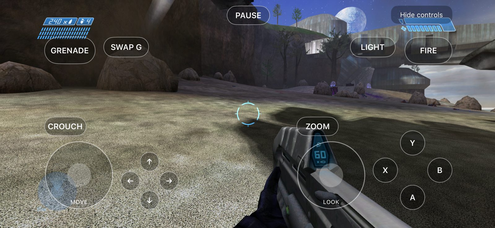
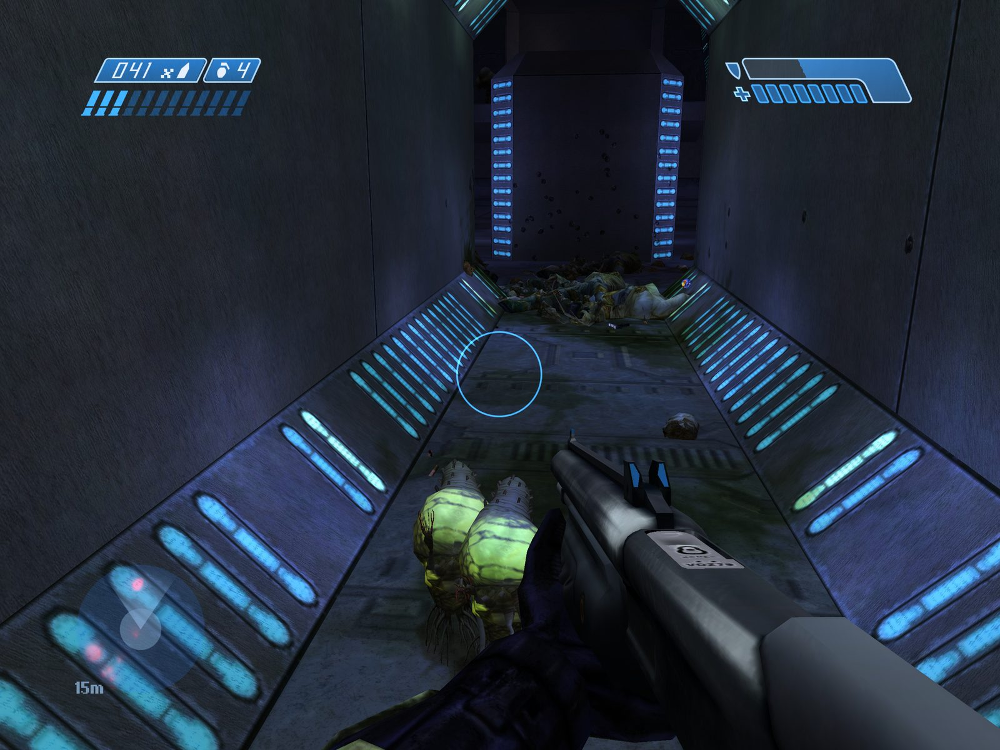
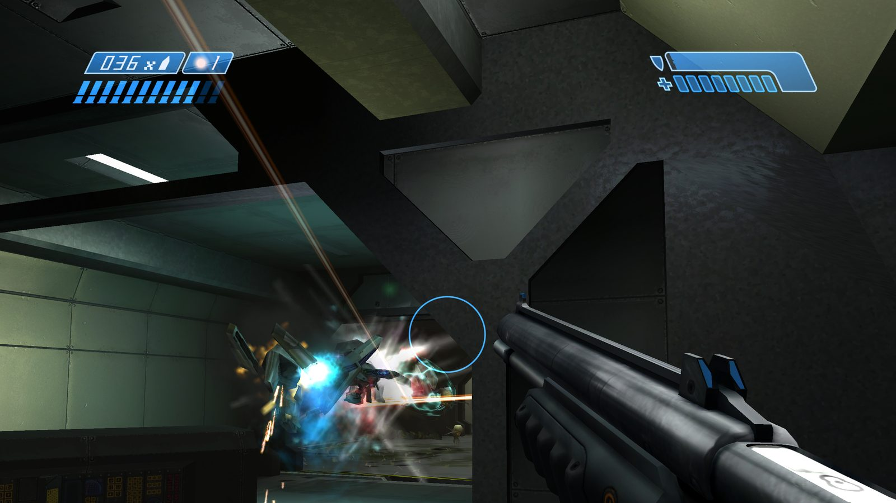
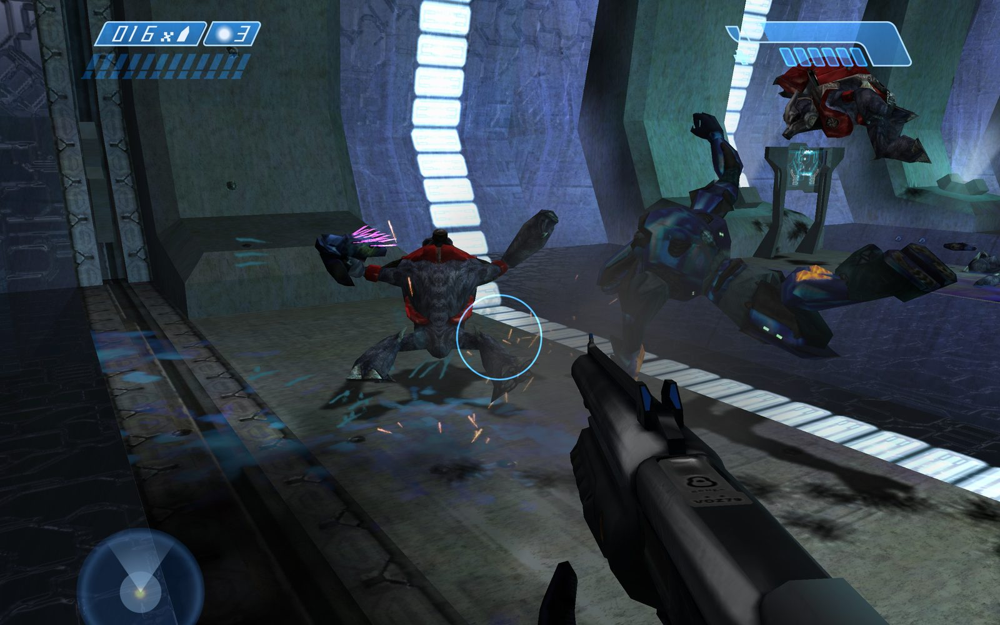

# VISR

## Experience *Halo: Combat Evolved* in a whole new dimension

VISR is a native port of Halo: Combat Evolved for Apple Vision Pro and other Apple devices: iPhone, iPad, Apple TV and Mac. Based on a lot of hard work from the community, optimized for Metal and Apple Silicon.

The goal is to provide the best possible ways to experience Halo while staying faithful to the original game. VISR builds on my love of the game and the many thousands of hours I have spent playing it.

> "The first VISR systems date back to the early 21st century…"
>
> — ["Dynasty" VISR, Halo 5: Guardians](https://www.halopedia.org/Armor_customization_(Halo_5:_Guardians)/Visor)

[Vision Pro](#apple-vision-pro) • [iPhone](#iphone-and-ipad) • [iPad](#iphone-and-ipad) • [AppleTV](#apple-tv) • [Mac](#mac) • [GitHub](https://github.com/steverice/visr)

## On every device

{{ shared: every-device }}

## Apple Vision Pro

{{ features: vision-pro }}

## iPhone and iPad

{{ features: iphone-and-ipad }}

{device=iphone}

{device=ipad}

## Apple TV

{{ features: apple-tv }}

{device=tv}

## Mac

{{ features: mac }}

{device=mac}
